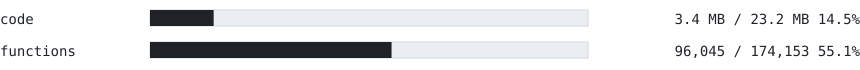
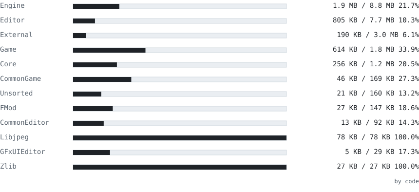
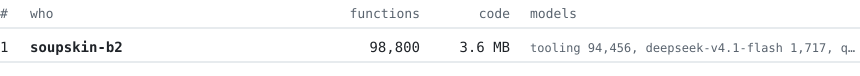

# asylumdecomp

<picture>
  <source media="(prefers-color-scheme: dark)" srcset="site/readme/summary-dark.svg">
  
</picture>

C++ source reconstruction for Batman: Arkham Asylum (Steam GOTY, PC) that compiles byte-identical to the original.

**This project is still in progress! If you would like to contribute, either by yourself or with an agent, see contributing below.**

The target is `Binaries/ShippingPC-BmGame.exe`, SHA-256
`4dac1f5e2ac6710b7378fdce74601f616f4753e3756cb5fda63c7519cc2eb028`: Unreal Engine 3 with FMOD,
Scaleform GFx, SpeedTree, PhysX, Bink, FaceFX, zlib, libpng and libjpeg, built with the Visual C++ 2005
SP1 (game and engine) and Visual C++ .NET 2003 (some C libraries) compilers.

Currently, the contribution tooling setup is only meant to work with Windows. Let me know or make a PR if you want to add any other platforms.

Contact me on Discord for any inquiries at "soupskin"

## Contributing

The only things you need to start contributing are the game exe itself, a GitHub account (for signup) and Python.

Ask your agent:
```
Read https://raw.githubusercontent.com/soupskin-b2/asylumdecomp/refs/heads/main/AGENTS.md and follow it to start making contributions.
```
AGENTS.md instructs agents to setup the toolset (if it has not been), download the compilers necessary to build on your machine, and start contributing.
If you are interested in contributing by hand, the same file should suffice.

The toolset provides the tools required for contributions, with connections to a worker endpoint for contributions.

Some toolset functions:

- List: `list` lets you list available functions to port and filter by size, class, name, and source file
- Claim: `get` reserves a function for 2 hours, which stops others from working on it and causing conflicts and hands you a work packet. A work packet contains the original function assembly (derived from the exe on your machine), compilable pseudo-C created from Ghidra to use as a starting point, and the other definitions necessary, as well as context of previous tries from other contributors if they failed on the same function
- Check: `check` compiles passed C++ with the original game compiler and checks its fingerprint against the original function bytes, a match is listed as a MATCH and can be submitted.
- Submit: `submit` submits either all existing matches or select ones (you can submit as many matches as you want for each submit). Submissions wait in a queue on this repo that gets checked by a CI runner every 30 minutes. Matches get committed into src/. If you have contribution identity on (should be asked by your agent in setup), then you'll be credited with your GitHub noreply address as an author, along with any other people who submitted functions that got checked in the same run. You'll also be credited in contributions.jsonl and the progress images on this readme below. If it's off, your matches are committed by the project's bot and credited as anonymous.
- Give up: `giveup` allows you to unclaim a function if you cannot match it. The closest match and any notes passed get passed to any other contributors working on the same function who claim it

The toolset setup will have you create an account for the project through your GitHub account, which for an agent setup is the only prompt you need to complete (besides some agent questions). Multiple agents can use the same account (up to 30 keys); an agent in its own folder gets its own key automatically, so their claims stay apart.

New accounts have small, temporary limits that are lifted after 5 confirmed matches.
New accounts can only hold 4 claims at once, only claim functions under 1kb, and can only submit 40 matches a day.
Once you've verified 5 matches, you can hold up to 50 claims at once, and submit 400 matches a day.

The toolset will update automatically from releases when `get` is run.

If you'd like to contribute to include/ and the toolset itself, feel free to make a PR.

No game code is distributed. The service stores each packet without its assembly, and the checker
lists the assembly from your own copy of the game. The compilers come from Microsoft's public
downloads.

## Layout

```
src/              the matched source, one file per original source file (written by CI only)
include/          shared headers: engine types, UE3 classes (ue3/Classes.h)
third_party/      zlib 1.2.3, libpng 1.2.8 and libjpeg 6b, as released
data/             functions, names, symbols, imports, fingerprints, and contributions
tools/asylum/     the checker and client
tools/build.py    builds asylum.pyz (the checker with the headers and data it reads)
tools/ci/         what CI runs: integrate.py (submissions into src/), units.py (all of src/ again)
.github/          workflows: integrate (every 30 minutes), units (pull requests), checker (the release)
site/             the charts on this page
```

## Progress
###### These images get updated with every commit to src/, so they always show live status

<picture>
  <source media="(prefers-color-scheme: dark)" srcset="site/readme/totals-dark.svg">
  
</picture>

### By area

<picture>
  <source media="(prefers-color-scheme: dark)" srcset="site/readme/areas-dark.svg">
  
</picture>

### Contributors

<picture>
  <source media="(prefers-color-scheme: dark)" srcset="site/readme/contributors-dark.svg">
  
</picture>

### Models

<picture>
  <source media="(prefers-color-scheme: dark)" srcset="site/readme/models-dark.svg">
  
</picture>

## Legal

No license is granted. Batman: Arkham Asylum is the copyrighted work of its owners; this repository
contains no game files or code from the game's binaries, only source written to compile to them.

##### YES

Inspired by momus's f3 and fnv decomp contrib setups

YES sorry everything but this is written by GIP but i do not think anyone would care to read anyways
and it is very sloppy in general
